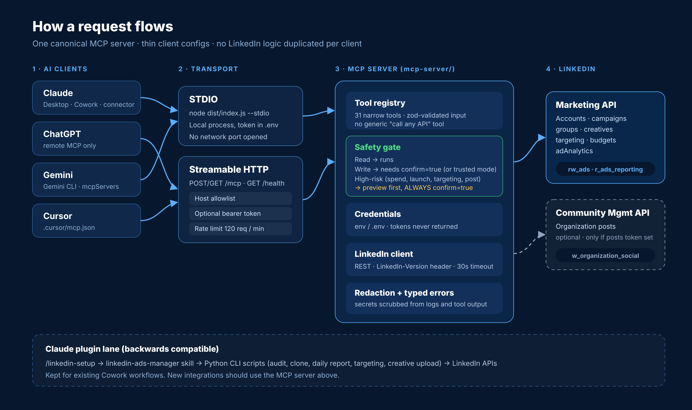
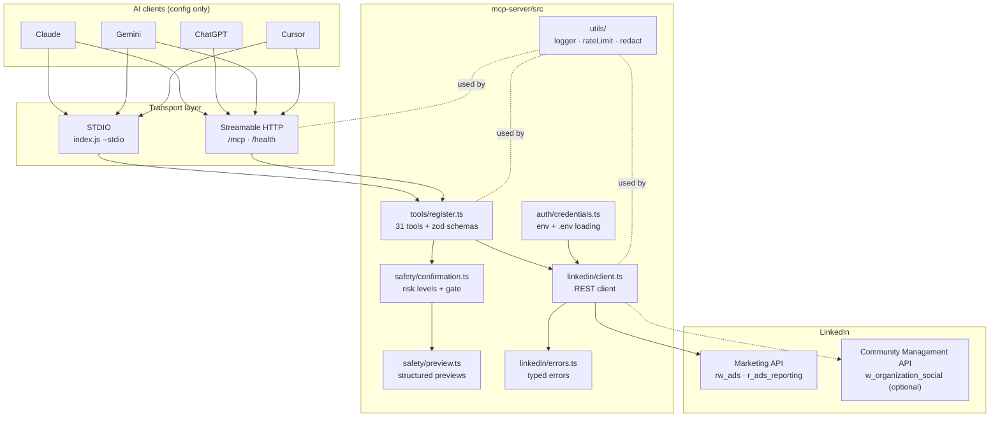
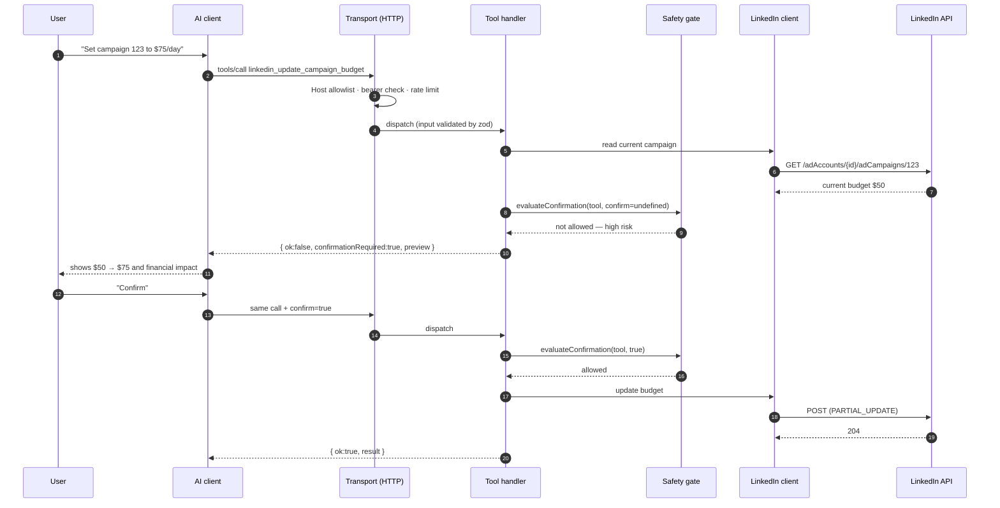
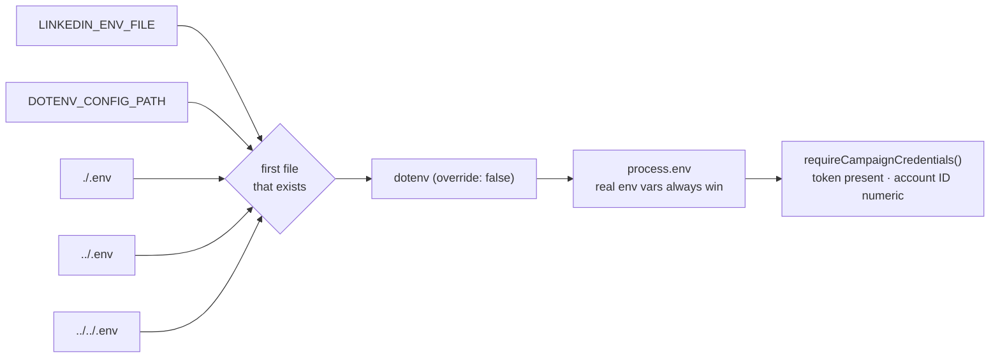
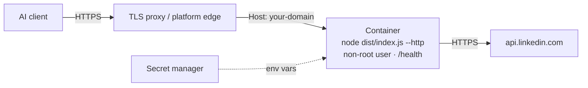

# Architecture

This document explains how LinkedIn Ads Manager MCP is built: the moving parts, how one request travels through them, where the safety rules live, and the design decisions behind them. For setup and usage, start with the [README](README.md).

<p align="center">
  
</p>

---

## Contents

1. [Design goals](#1-design-goals)
2. [System overview](#2-system-overview)
3. [Components](#3-components)
4. [Request lifecycle](#4-request-lifecycle)
5. [Safety model](#5-safety-model)
6. [Credentials and secrets](#6-credentials-and-secrets)
7. [Transports](#7-transports)
8. [LinkedIn API client](#8-linkedin-api-client)
9. [Error model](#9-error-model)
10. [The Claude plugin lane](#10-the-claude-plugin-lane)
11. [Testing strategy](#11-testing-strategy)
12. [Deployment topology](#12-deployment-topology)
13. [Design decisions](#13-design-decisions)
14. [Known limitations](#14-known-limitations)
15. [Extending the server](#15-extending-the-server)

---

## 1. Design goals

| Goal | What it means in practice |
|---|---|
| **One implementation** | Every AI client talks to the same server in `mcp-server/`. Client folders hold configuration only. |
| **Safe by default** | Nothing that can spend money, launch a campaign or post publicly runs without a preview and an explicit `confirm=true`. |
| **Narrow tools** | 31 purpose-built tools with validated input. No generic "call any endpoint" escape hatch. |
| **Secrets stay put** | Tokens are read from the environment and never appear in tool output, logs or errors. |
| **Runs anywhere** | Local STDIO for desktop tools, Streamable HTTP for hosted and ChatGPT use, Docker for production. |
| **Backwards compatible** | The original Claude plugin (`/linkedin-setup`, skill, Python CLI) keeps working. |

---

## 2. System overview



---

## 3. Components

| Path | Responsibility |
|---|---|
| `src/index.ts` | CLI entry point. Parses `--stdio`, `--http`, `--help`; falls back to `MCP_TRANSPORT`, then to HTTP if `PORT` is set, else STDIO. Loads credentials before starting. |
| `src/server.ts` | Builds an `McpServer` named `linkedin-ads-manager` and registers all tools. |
| `src/tools/register.ts` | Defines every tool: name, title, description, zod input schema and handler. |
| `src/tools/helpers.ts` | Shared handler plumbing: `withClient`, `gateWrite`, `jsonResult`, `errorResult`. All output passes through `sanitizeForOutput`. |
| `src/safety/confirmation.ts` | Classifies each tool as `read`, `write` or `high_risk` and decides whether a call may execute. |
| `src/safety/preview.ts` | Builds the structured preview returned when confirmation is needed. |
| `src/auth/credentials.ts` | Finds and loads `.env`, validates required variables, reports configuration status without values. |
| `src/linkedin/client.ts` | Thin REST client for `https://api.linkedin.com/rest` with versioned headers, timeouts and error mapping. |
| `src/linkedin/types.ts` | Types for ad accounts, campaigns, groups, creatives and analytics rows. |
| `src/linkedin/errors.ts` | `LinkedInApiError`, `LinkedInValidationError`, `LinkedInTimeoutError`, and `formatToolError`. |
| `src/transport/stdio.ts` | Connects the server to stdin/stdout. |
| `src/transport/http.ts` | Express app exposing `/mcp` and `/health`, with host allowlist, bearer auth and rate limiting. |
| `src/utils/logger.ts` | Levelled structured logging (`debug` → `error`) to stderr. |
| `src/utils/rateLimit.ts` | In-memory sliding-window rate limiter keyed per client. |
| `src/utils/redact.ts` | Removes bearer tokens, env-style tokens, JSON secrets and long secret-like strings. |

---

## 4. Request lifecycle

The example below is a high-risk call — raising a campaign budget — because it exercises every layer.



For read tools, steps 6–11 collapse: the handler calls the client and returns the sanitized result directly.

---

## 5. Safety model

### Risk levels

| Level | Tools | Behaviour |
|---|---|---|
| **read** | everything not listed below | Executes immediately |
| **write** | `update_campaign`, `create/update_campaign_group`, `create/update_creative`, `update_organization_post` | Needs `confirm=true`, unless `LINKEDIN_TRUSTED_EXECUTION=true` |
| **high_risk** | `create_campaign`, `clone_campaign`, `pause_campaign`, `resume_campaign`, `update_campaign_budget`, `update_campaign_targeting`, `create_organization_post` | Preview first; **always** needs `confirm=true`, even in trusted mode |

The lists live in `HIGH_RISK_TOOLS` and `WRITE_TOOLS` in `safety/confirmation.ts`. Any tool not in either set is treated as a read, so **a new write tool must be added to one of them** — see [Extending the server](#15-extending-the-server).

### Preview contents

```jsonc
{
  "ok": false,
  "confirmationRequired": true,
  "reason": "High-risk LinkedIn Ads action requires explicit confirmation…",
  "preview": {
    "requiresConfirmation": true,
    "tool": "linkedin_update_campaign_budget",
    "account": "123456789",
    "campaign": { "id": "123", "name": "Dallas Roadshow" },
    "currentState": { "dailyBudget": { "amount": "50", "currencyCode": "USD" } },
    "requestedState": { "dailyBudget": { "amount": "75", "currencyCode": "USD" } },
    "budgetChange": { "from": "…", "to": "…" },
    "expectedImpact": "…",
    "financialImplications": "…",
    "irreversible": false,
    "message": "Confirmation required. Re-invoke this tool with the same parameters and confirm=true…"
  }
}
```

### Guarantees

- New campaigns default to `DRAFT`.
- The server never raises a budget, launches a campaign or publishes a post without `confirm=true` on that exact call.
- Confirmation is per call. There is no session-wide "approve everything" switch for high-risk tools.

---

## 6. Credentials and secrets



- Variables already in the environment are never overwritten by a file.
- `LINKEDIN_ACCOUNT_ID` must be numeric; a clear error is raised otherwise.
- `LINKEDIN_POSTS_TOKEN` is optional; organization tools fail with an explanatory message when it is missing.
- `/health` and status calls report only *whether* values are configured, plus a masked token preview.
- `sanitizeForOutput` replaces any object key containing `token`, `secret`, `password` or equal to `authorization` with `[REDACTED]`, and `redactSecrets` scrubs strings.

---

## 7. Transports

| | STDIO | Streamable HTTP |
|---|---|---|
| Start | `node dist/index.js --stdio` | `node dist/index.js --http` (or `PORT` set) |
| Used by | Claude Desktop, Cursor, Gemini CLI | ChatGPT, remote connectors, hosted setups |
| Network exposure | None | `/mcp` (POST/GET) and `/health` (GET) |
| Auth | OS process boundary | Optional `MCP_HTTP_BEARER_TOKEN` |
| Host check | n/a | `localhost`, `127.0.0.1`, `[::1]` + `ALLOWED_HOSTS` |
| Rate limit | n/a | `MCP_RATE_LIMIT_MAX` per `MCP_RATE_LIMIT_WINDOW_MS` per client (default 120/min) |
| Server lifetime | One server for the process | A fresh MCP server per request (`responseMode: "json"`), so requests are stateless |
| Shutdown | process exit | `SIGINT`/`SIGTERM` close the handler and listener (disable with `MCP_HTTP_HANDLE_SIGNALS=0`) |

SSE is intentionally not the primary remote transport; Streamable HTTP is.

---

## 8. LinkedIn API client

- **Base URL:** `https://api.linkedin.com/rest`
- **Headers:** `Authorization: Bearer …`, `X-Restli-Protocol-Version: 2.0.0`, `LinkedIn-Version: ${LINKEDIN_API_VERSION:-202601}`, and `X-RestLi-Method: PARTIAL_UPDATE` for partial updates.
- **Tokens:** campaign tools use `LINKEDIN_CAMPAIGNS_TOKEN`; organization tools switch to `LINKEDIN_POSTS_TOKEN`.
- **Timeouts:** each call races an `AbortController` timer (`LINKEDIN_HTTP_TIMEOUT_MS`, default 30 s).
- **IDs:** campaign IDs are accepted as plain numbers or full URNs (`urn:li:sponsoredCampaign:…`) and normalized.
- **Testability:** `fetchImpl`, `baseUrl`, `apiVersion` and `timeoutMs` are injectable, which is how the test suite mocks LinkedIn.

---

## 9. Error model

| Error | When | What the AI client sees |
|---|---|---|
| `LinkedInValidationError` | Missing token, bad input | Plain message, `isError: true` |
| `LinkedInApiError` | Non-2xx response | `LinkedIn API error (status): message. Retry after Ns.` (message redacted) |
| `LinkedInApiError(429)` | LinkedIn rate limit | Same, with `Retry-After` seconds when provided |
| `LinkedInTimeoutError` | Call exceeded timeout | `LinkedIn API request timed out` |
| `CredentialError` | Required env var missing or invalid | Setup guidance pointing to `/linkedin-setup` or `docs/authentication.md` |

All tool errors are returned as JSON (`{ "ok": false, "error": "…" }`) so a model can read them and recover, rather than crashing the session.

---

## 10. The Claude plugin lane

```text
/linkedin-setup  →  .env in the Cowork project folder
        │
        ▼
linkedin-ads-manager skill (SKILL.md + references/)
        │
        ▼
Python CLI scripts (linkedin_api.py, audit_campaigns*.py, clone_campaign.py,
daily_report.py, update_targeting.py, upload_image_creative.py, post_*.py …)
        │
        ▼
LinkedIn APIs
```

This lane predates the MCP server and is kept so existing Cowork users are not broken. It shares the same `.env` variable names. New capabilities should be built in `mcp-server/` first.

---

## 11. Testing strategy

| Test file | Covers |
|---|---|
| `confirmation.test.ts` | Risk classification and gate decisions, including trusted mode |
| `credentials.test.ts` | Required variables, numeric account ID, posts-token requirement |
| `linkedin-client.test.ts` | Invalid IDs, error mapping and redaction, rate limits, timeouts, draft-by-default creation, posts token (mocked `fetch`) |
| `mcp-protocol.test.ts` | Initialize, every tool listed with schemas, budget preview returned without `confirm` |
| `http-transport.test.ts` | `/health` response and MCP `initialize` over `/mcp` |
| `rateLimit.test.ts` | Sliding-window limiter behaviour |
| `redact.test.ts` | Secret scrubbing patterns |
| `scripts/smoke-mcp.ts` | End-to-end smoke run of the built server |

Run everything with `npm run lint && npm run typecheck && npm test && npm run test:mcp && npm run smoke`.

---

## 12. Deployment topology



Checklist for a public deployment:

- [ ] HTTPS in front of the container
- [ ] `MCP_HTTP_BEARER_TOKEN` set
- [ ] `ALLOWED_HOSTS` set to your domain
- [ ] Tokens supplied from the platform's secret store, not baked into the image
- [ ] Health check pointed at `/health`

---

## 13. Design decisions

| Decision | Why |
|---|---|
| One server, config-only clients | Fixes and safety rules land once and apply everywhere. |
| No generic API-call tool | Keeps every action reviewable and prevents a model from reaching endpoints the safety gate does not understand. |
| Preview-then-confirm instead of a separate approval UI | Works in every MCP client today without client-specific features. |
| High-risk tools ignore trusted mode | Trusted mode is a convenience for edits, never for spend or publishing. |
| Stateless HTTP handling | Simplifies horizontal scaling and avoids session leaks between users. |
| Two LinkedIn apps | LinkedIn does not allow Marketing Developer Platform and Community Management API in one app. |

---

## 14. Known limitations

These are tracked as issues and on the roadmap:

- No automatic retry or back-off on LinkedIn `429`/`5xx`; the error is surfaced to the model.
- List calls return a single page; large accounts may need pagination.
- Analytics use `timeGranularity=ALL` with a fixed field set; no daily breakdown or demographic pivots yet.
- The rate limiter is in-memory, so limits are per instance, and the client key trusts `X-Forwarded-For`.
- One ad account per server instance (`LINKEDIN_ACCOUNT_ID`); no OAuth refresh flow.
- `SERVER_VERSION` in `server.ts` is hard-coded and must be kept in step with `package.json`.

---

## 15. Extending the server

1. **Add the client method** in `linkedin/client.ts` (and types in `linkedin/types.ts`).
2. **Register the tool** in `tools/register.ts` with a precise description and a zod schema. Include `confirm: confirmSchema` if it writes.
3. **Classify it** — add the name to `WRITE_TOOLS` or `HIGH_RISK_TOOLS`. Anything that can spend, launch, change who sees ads, or publish is high-risk.
4. **Gate it** — wrap execution in `gateWrite` with a `buildPreview` that shows current vs requested state and the money impact.
5. **Test it** — client behaviour with mocked `fetch`, gate behaviour, and an MCP protocol call.
6. **Document it** — add it to the tool table in the README and to the client prompt examples.
