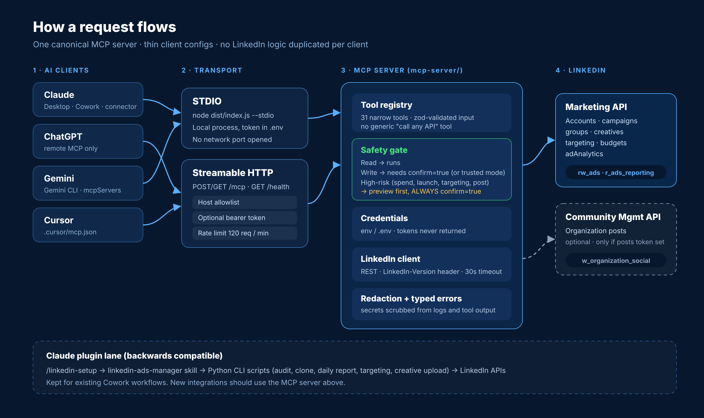

# Architecture

The full architecture write-up now lives in the repository root: **[ARCHITECTURE.md](../ARCHITECTURE.md)**.

It covers design goals, components, the request lifecycle, the safety model, credentials, transports, the LinkedIn client, errors, the Claude plugin lane, tests, deployment and how to add a new tool.

